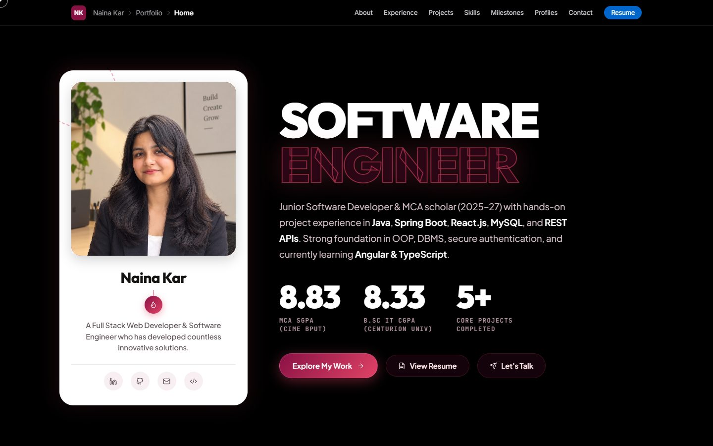

# 🌟 Naina Kar — Personal Portfolio Website

🌐 **Live Site:** [https://nainakar-portfolio.vercel.app/](https://nainakar-portfolio.vercel.app/)

[](https://nainakar-portfolio.vercel.app/)
[](https://nainakar-portfolio.vercel.app/)
[](https://github.com/NainaKar)
[-FF69B4?style=flat-square)](https://github.com/NainaKar)

---

## 📸 Preview

[](https://nainakar-portfolio.vercel.app/)

*Click the preview image above to explore the live interactive experience.*

---

## 👩‍💻 About

Welcome to the official repository for **Naina Kar's** personal portfolio website. This platform showcases full-stack web architectures, software engineering milestones, cybersecurity assessments, and machine learning projects crafted with high-fashion editorial typography and interactive 3D elements.

---

## 🎨 Theme & Design Highlights

- **Luxury Palette**: Deep Burgundy (`#800021`), Rich Berry (`#881144`), Vibrant Raspberry (`#E24366`), Blush Mauve (`#EA869E`), and Rose Glow (`#FF69B4`).
- **Hero Stage**: Editorial pinned scroll statement with dynamic name docking interaction (`NAINA` translates to dock alongside `KAR`) and backdrop portrait framing.
- **Interactive Experience**:
  - Three.js starlight celestial particle canvas with mouse parallax.
  - Floating glass-pill navigation with real-time scroll indicator.
  - Interactive skill filtering with staggered transitions.
  - Vertical animated experience timeline with scroll progress tracking.
  - Interactive digital resume modal with print/save as PDF support.

---

## 🛠️ Tech Stack

- **Frontend Core**: HTML5, CSS3 (Bespoke Glassmorphism & Editorial Layouts), Vanilla JavaScript (ES6+), React.js
- **3D & Motion**: Three.js, GSAP & ScrollTrigger
- **Typography & Icons**: Self-hosted in `assets/icons/` — brand logos from Devicon & Simple Icons, UI icons from Lucide SVG sprite; Google Fonts (Anton, Bebas Neue, Inter, Outfit, Plus Jakarta Sans, JetBrains Mono)
- **Dependencies**: `opentype.js` (^2.0.0)
- **Local Server**: Lightweight Node.js HTTP server (`server.js`)
- **Hosting & Deployment**: [Vercel](https://vercel.com/)

---

## 🚀 Projects Featured

The portfolio highlights selected engineering works across full-stack development, security, and machine learning:

1. **DevTrack: Developer Career Intelligence & Skills Platform**
   - A career readiness platform that measures developer competencies, calculates a realistic job readiness score (85% weighted skill coverage + 15% project completion), and generates adaptive milestone-driven learning roadmaps across 9 engineering roles with an AI career mentor.
   - **Stack**: Angular 19, TypeScript, Angular Signals, Supabase (Auth + PostgreSQL + RLS), Node.js, Express, Netlify
   - **Links**: [🌐 Live Demo](https://devtrack0.netlify.app/) · [💻 Source Code](https://github.com/NainaKar/Devtrack)

2. **Job Sphere**
   - A high-performance job application portal connecting recruiters and talent, architected with reusable component states and relational MySQL schemas.
   - **Stack**: React, Spring Boot, Java, MySQL, REST APIs

3. **Secure Login Authentication System**
   - Zero-trust authentication infrastructure designed to neutralize OWASP vulnerabilities using salted cryptographic hashing (PBKDF2/BCrypt) and parameterized queries against SQL injection.
   - **Stack**: Java, SQL, Cryptographic Hashing

4. **Password Strength Analyzer**
   - Real-time cryptographic entropy evaluator analyzing character space dispersion and dictionary collision heuristics for instant complexity ratings.
   - **Stack**: Java, Entropy Algorithms

5. **Editorial Portfolio**
   - Interactive personal portfolio website featuring Three.js celestial particle fields, GSAP scroll triggers, and responsive editorial typography.
   - **Stack**: HTML5, CSS3, JavaScript (ES6+), Three.js, GSAP
   - **Links**: [🌐 Live Site](https://nainakar-portfolio.vercel.app/)

6. **Culinary Concept Platform**
   - Dining brand digital showcase featuring interactive menu presentations, mobile reservation funnel, and responsive UX design.
   - **Stack**: WordPress, Figma, Responsive UI/UX

---

## 📂 Project Structure

```text
├── assets/
│   ├── images/
│   │   ├── naina_professional.jpg   # Main professional portrait
│   │   ├── devtrack.jpg             # DevTrack platform preview
│   │   ├── jobsphere.jpg            # JobSphere project preview
│   │   ├── security_project.jpg     # Secure login system preview
│   │   ├── aiml_project.jpg         # Password strength analyzer preview
│   │   ├── portfolio.jpg            # Portfolio website preview
│   │   └── restaurant.jpg           # Restaurant website preview
│   ├── fonts/                       # Self-hosted typography
│   └── icons/                       # Self-hosted tech & UI icons
├── index.html                       # Main portfolio landing page
├── style.css                        # Complete responsive design system
├── script.js                        # Three.js 3D cosmos, GSAP animations & interactivity
├── server.js                        # Zero-dependency local Node.js server
├── package.json                     # NPM scripts & dependencies
└── README.md                        # Documentation
```

---

## 💻 Run Locally

### Prerequisites
- [Node.js](https://nodejs.org/) (v14 or higher recommended)

### Setup & Launch
```bash
# 1. Clone the repository
git clone https://github.com/NainaKar/nainakar-portfolio.git
cd "Naina kar Portfolio web"

# 2. Install dependencies
npm install

# 3. Start the local server
npm start
# or
npm run dev
```

The server will start locally at **`http://localhost:3000`**.

Alternatively, you can double-click `index.html` to open and view the portfolio directly in any modern web browser without running a server.

---

## 🌐 Deployment

This website is automatically built and deployed via **[Vercel](https://vercel.com/)**:

- **Production URL**: [https://nainakar-portfolio.vercel.app/](https://nainakar-portfolio.vercel.app/)
- **Repository Branch**: `main`

---

## 📬 Contact & Connect

- **GitHub**: [https://github.com/NainaKar](https://github.com/NainaKar)
- **LinkedIn**: [Naina Kar](https://linkedin.com)
- **Email**: [nainakar2000@gmail.com](mailto:nainakar2000@gmail.com)
- **Location**: Soro, Balasore, Odisha, India

---

Built by Naina Kar. Visit the live site: https://nainakar-portfolio.vercel.app/
